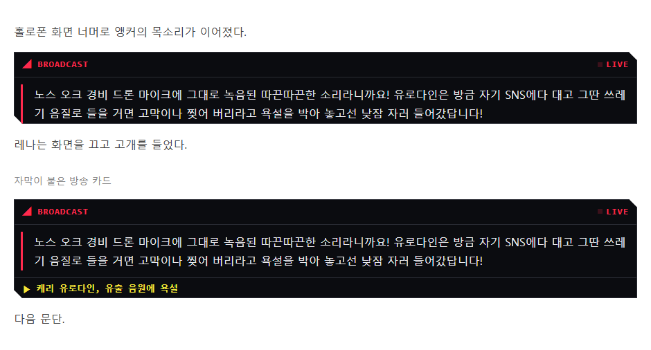
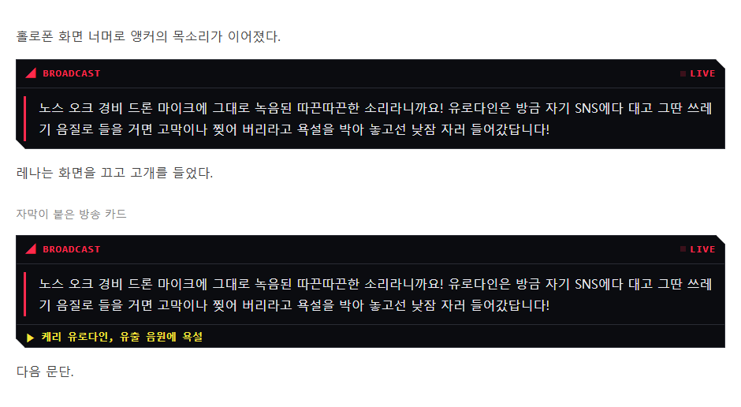
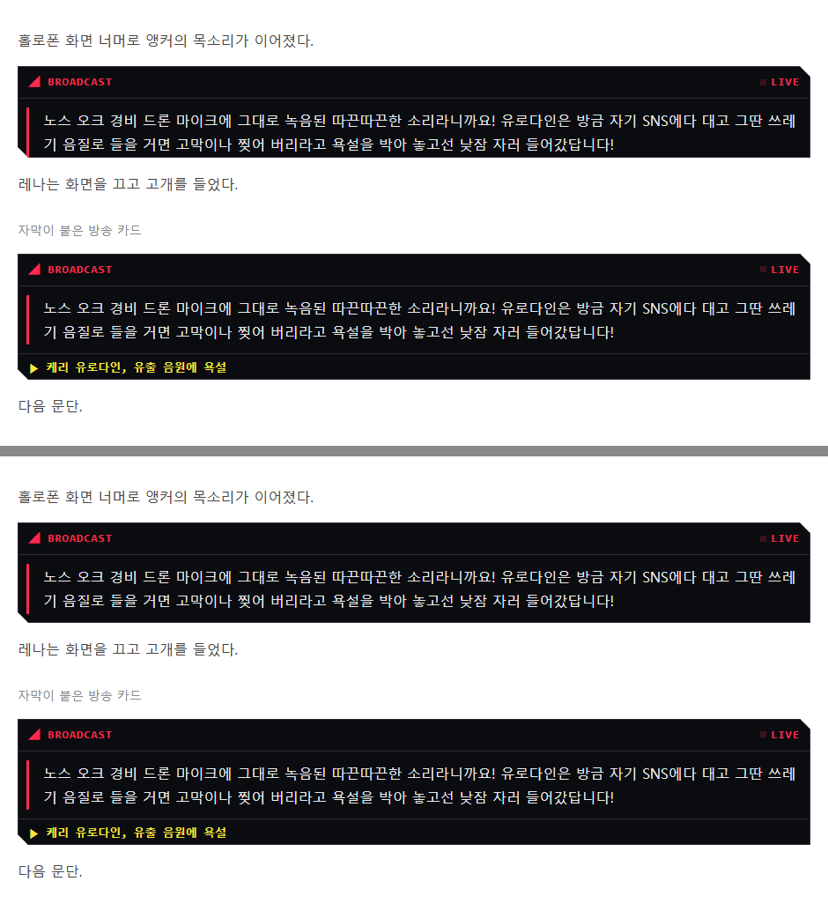

# 방송 카드 아래 여백 시안 (2026-11-13)

확인용이에요. 앱 업데이트가 아니에요. 각 그림의 위 카드는 자막 없는 방송, 아래 카드는 자막(▶ 소식 제목)이 붙은 방송이에요.

## 지금 (자막 없는 카드: 글 위 10px, 아래 0px)

## 고친 뒤 (위 10px, 아래 10px)

## 위아래 비교 (위: 지금, 아래: 고친 뒤)

