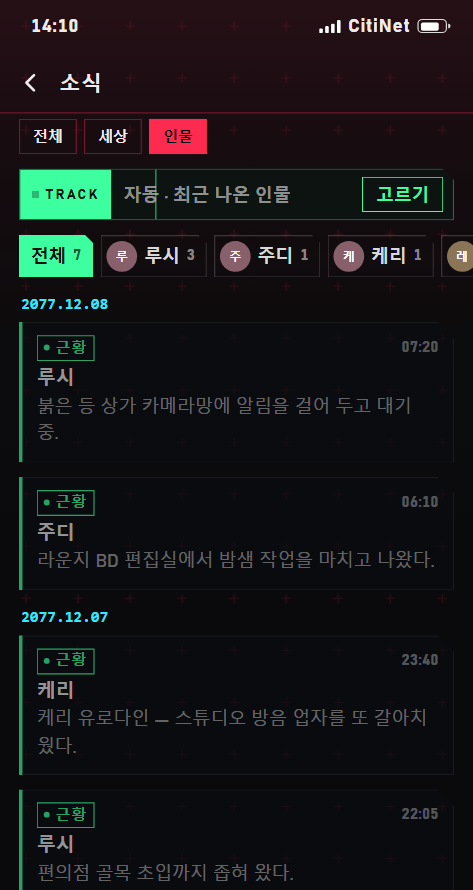
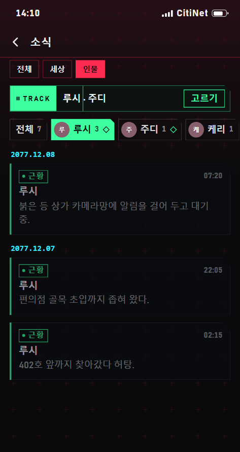
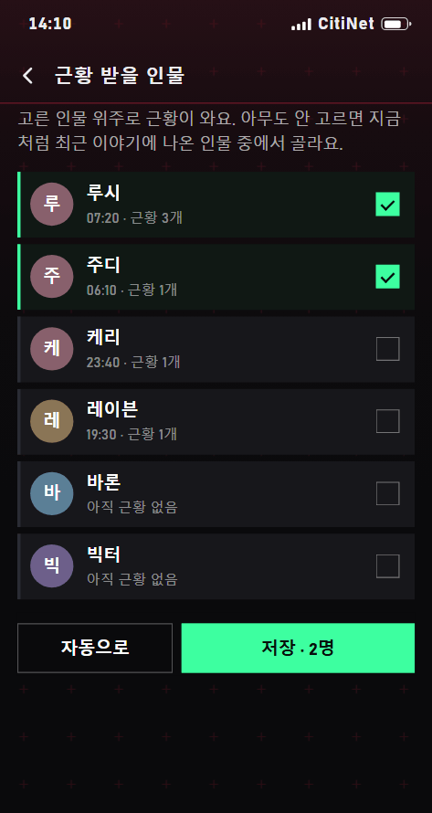

# 소식 앱 인물 탭 시안 (2026-11-13)

확인용 GIF예요. 앱 업데이트가 아니에요.

## ① 인물 탭 · 아무도 안 골랐을 때 (TRACK 자동, 위에 인물 칩: 전체·루시·주디·케리·레이븐)

## ② 인물 칩으로 보기 거르기 (루시만 → 주디를 누르면 주디만, ◇ 표시는 근황 받을 인물)

## ③ TRACK 「고르기」 → 근황 받을 인물 고르기 (대화 기억 인물·연락처, 케리를 눌러 추가 → 저장)

